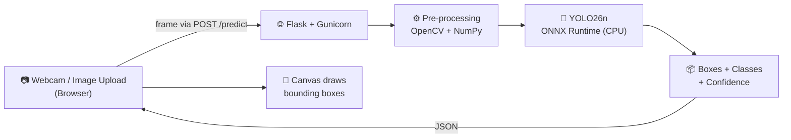
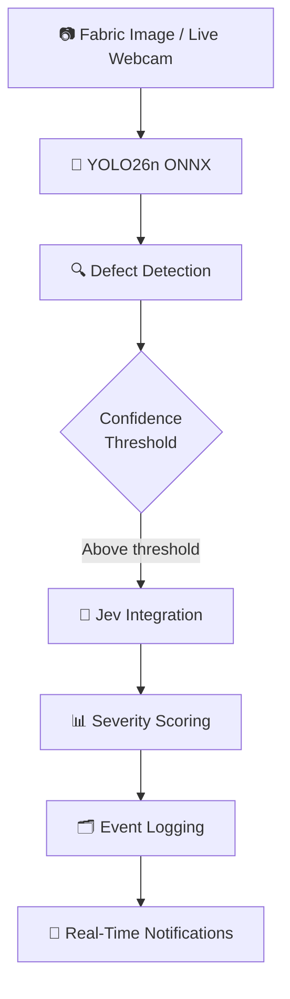

<div align="center">

# 🧵 Fabric Defect Detection System

### Real-time textile defect detection that runs on a **CPU**, in **under 150 MB of RAM**.

**YOLO26n · ONNX Runtime · Flask · Vanilla JS**

<br>


<br>

[Why](#-why-this-project-exists) •
[Features](#-features) •
[Architecture](#-architecture) •
[Performance](#-model-performance) •
[Quickstart](#-quickstart) •
[Deploy](#-deploy-on-render) •
[Roadmap](#-roadmap)

</div>

---

## 📖 Table of Contents

- [Why This Project Exists](#-why-this-project-exists)
- [Features](#-features)
- [Detected Defects](#-detected-defects)
- [Tech Stack](#-tech-stack)
- [Architecture](#-architecture)
- [Why ONNX Instead of PyTorch?](#-why-onnx-instead-of-pytorch)
- [Model Performance](#-model-performance)
- [Quickstart](#-quickstart)
- [Deploy on Render](#-deploy-on-render)
- [Roadmap](#-roadmap)
- [Notes and Limitations](#-notes-and-limitations)

---

## 🎯 Why This Project Exists

Traditional textile quality inspection usually means one of three things:

| Approach | Problem |
|---|---|
| 👀 Manual visual inspection | Slow, tiring, and inconsistent between inspectors |
| 🖥️ GPU-powered vision systems | Expensive hardware and infrastructure |
| 🧠 Heavy deep learning stacks | Hard to deploy on low-end machines |

**This project takes a different path:** a small 4-class YOLO26n detector, exported to ONNX and served with ONNX Runtime, so it can run **without PyTorch, without a GPU**, and on very modest hardware.

> **The goal:** make computer vision practical on low-end devices, edge CPUs, and constrained cloud infrastructure.

### 📊 At a Glance

| | |
|---|---|
| **Detection classes** | 4 (`hole`, `oil`, `slub`, `snag`) |
| **Original PyTorch model** | 5.5 MB (`.pt`) |
| **Exported ONNX model** | 9.4 MB (`.onnx`) |
| **Production inference** | ONNX Runtime (`CPUExecutionProvider`) |
| **Target RAM** | Under 150 MB |
| **Deployment target** | Render Free Tier (512 MB RAM) |

---

## ✨ Features

- ⚡ **CPU-only inference** with ONNX Runtime, no GPU needed
- 🪶 **No PyTorch in production**, which removes roughly 2 GB of dependencies
- 📷 **Live webcam detection** straight in the browser
- 🖼️ **Image upload** for single-image inference
- 🎨 **Client-side bounding box rendering** on an HTML5 Canvas
- 📡 **Lightweight JSON responses** instead of streaming processed video
- 🧠 **Model loaded once** at startup and shared across requests
- ☁️ **Built for tiny cloud instances**, with a single Gunicorn worker to avoid duplicating the model in memory

---

## 🔍 Detected Defects

| Class | Description |
|:---:|---|
| 🕳️ `hole` | Holes or missing fabric material |
| 🛢️ `oil` | Oil stains or contamination |
| 🧶 `slub` | Irregular thick yarn or uneven fabric texture |
| 🪝 `snag` | Pulled or hooked yarn |

---

## 🛠️ Tech Stack

| Layer | Technology |
|---|---|
| **Model** | Ultralytics YOLO26n |
| **Export format** | ONNX |
| **Inference runtime** | ONNX Runtime (`CPUExecutionProvider`) |
| **Image processing** | OpenCV (headless) + NumPy |
| **Backend** | Python, Flask |
| **Production server** | Gunicorn |
| **Frontend** | HTML5 Canvas + Vanilla JavaScript |
| **Hosting** | Render (512 MB free tier target) |

---

## 🏗️ Architecture

The server does one job only: **run inference and return JSON**. Drawing the boxes on the video happens in the browser, which keeps server work and bandwidth low.



### Design Decisions

**Why Flask?**
- Minimal framework overhead
- ONNX model is loaded **once** at application startup
- A single Gunicorn worker (`--workers 1`) avoids duplicating model memory
- A JSON `/predict` endpoint handles inference
- The same app serves the live webcam interface
- Returns bounding box coordinates and class predictions, not processed video

**Why Render?**
- A constrained environment is a good stress test for CPU-only computer vision
- No GPU infrastructure needed
- Fast, lightweight startup
- Only JSON detection results travel over the network, not heavy video streams

---

## ⚖️ Why ONNX Instead of PyTorch?

Serving the original `.pt` file needs PyTorch and its runtime dependencies, which increases both install size and memory usage. ONNX exports the model as a standalone computational graph that ONNX Runtime can execute directly.

| Factor | PyTorch (`.pt`) | ONNX (`.onnx`) |
|---|---|---|
| Runtime | PyTorch | ONNX Runtime |
| Model file size | 5.5 MB | 9.4 MB |
| CPU execution | ✅ Supported | ✅ Supported |
| Heavy PyTorch dependency | ❌ Required | ✅ Not required |
| Total deployment footprint | Higher | **Lower** |
| Edge portability | More complex | Simplified |

> 💡 The `.onnx` file itself is slightly larger than the `.pt` file. The savings come from dropping the **~2 GB PyTorch dependency**, not from the model file.

**Engineering advantages**
- Removes the heavy PyTorch install from production
- Targets inference memory usage below 150 MB
- Optimized CPU execution through ONNX Runtime
- Runs without a dedicated GPU
- Portable model-serving architecture

> 📝 A **2x to 3x CPU speedup** is a *target* advantage, not a guaranteed benchmark. Actual speed depends on the CPU, input resolution, preprocessing, and runtime configuration.

---

## 📈 Model Performance

### Validation Results (25 epochs)

| Metric | Result |
|---|---:|
| 🏆 **Overall mAP50** | **83.4%** |
| 🕳️ Hole mAP50 | 92.3% |
| 🛢️ Oil mAP50 | 91.7% |
| 🪝 Snag mAP50 | 85.7% |
| 🧶 Slub mAP50 | 64.1% |
| ⚡ **Inference speed** | **7.6 ms** |

### Per-Class mAP50

```text
Hole  ██████████████████▍  92.3%
Oil   ██████████████████▎  91.7%
Snag  █████████████████▏   85.7%
Slub  ████████████▊        64.1%
```

### Observations

- ✅ **Hole** and **oil** are the strongest classes
- ✅ **Snag** is solid at 85.7% mAP50
- 🎯 **Slub** is the main improvement target at 64.1%, since it is visually subtle and easy to confuse with normal fabric texture
- 📊 Overall validation mAP50 reaches **83.4%**

> ⚠️ The **7.6 ms** figure reflects the original benchmark environment. It is **not** a guaranteed latency on Render or other hosts.

---

## 🚀 Quickstart

### Prerequisites

- Python **3.10+**
- Git
- A webcam (for live detection)
- The exported ONNX model file

### 1️⃣ Clone the repository

```bash
git clone https://github.com/YOUR_USERNAME/fabric-defect-detection.git
cd fabric-defect-detection
```

### 2️⃣ Create a virtual environment

**Windows**

```bash
python -m venv venv
venv\Scripts\activate
```

**Linux / macOS**

```bash
python3 -m venv venv
source venv/bin/activate
```

### 3️⃣ Install dependencies

```bash
pip install -r requirements.txt
```

### 4️⃣ Add the ONNX model

Place the exported model in the model directory:

```text
models/
└── best.onnx
```

> Make sure the model path in the Flask app matches the real file location.

### 5️⃣ Run the app

```bash
python app.py
```

Then open **http://127.0.0.1:5000** in your browser. 🎉

---

## ☁️ Deploy on Render

1. **Push** the project to GitHub.
2. On Render, create a new **Web Service**.
3. **Connect** your GitHub repository.
4. Choose the **Python** build environment.
5. Add any required **environment variables**.
6. Set the **start command**:

```bash
gunicorn app:app --workers 1 --threads 2 --bind 0.0.0.0:$PORT
```

> 💡 **Why one worker?** Each Gunicorn worker loads its own copy of the model. A single worker plus two threads keeps memory low enough for the 512 MB free tier.

> ⏳ Free-tier availability, sleeping behavior, cold starts, and resource limits follow Render's current plan policies. Real-time availability is **not guaranteed** while an instance is asleep.

---

## 🗺️ Roadmap

### 📱 Edge and Mobile Rollout

- [ ] Quantized ONNX models for lower memory use
- [ ] TFLite deployment for compatible edge devices
- [ ] ONNX Runtime Web for in-browser inference
- [ ] Factory-floor deployment on low-end CPU hardware
- [ ] Mobile browser support
- [ ] Lower latency through optimized preprocessing and execution
- [ ] Better **slub** detection (more data and tuning)

### 🔔 Automated Event Pipeline: Jev Integration

Connect the detector to **Jev** so predictions become automated inspection events.



**Planned capabilities**

- [ ] Stream high-confidence defect triggers into Jev
- [ ] Automatically score defect severity
- [ ] Log inspection events with timestamps and defect classes
- [ ] Send instant notifications when damage crosses configured thresholds
- [ ] Keep inspection history for quality-control analysis
- [ ] Support automated textile quality monitoring workflows

---

## 📝 Notes and Limitations

- Reported metrics come from a 25-epoch validation run and may differ on your own fabric images, lighting, and camera.
- Latency and memory depend heavily on the host CPU and input resolution.
- Slub detection is still the weakest class and should be treated accordingly in real inspection workflows.

---

<div align="center">

**Built for efficient computer vision. Designed for constrained hardware. Engineered for the edge.**

⭐ If this project helps you, consider giving it a star!

</div>
